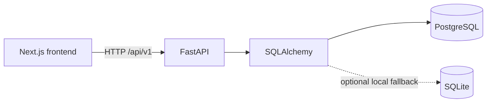
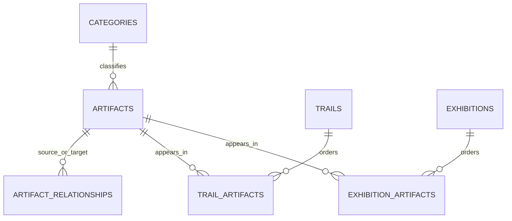

# Object Stories

Object Stories is an editorial digital museum for exploring the stories behind historical and everyday objects—and the relationships that connect them.

## Features

- A responsive Next.js editorial collection and interactive object detail experience, connected to a separate FastAPI API and The Metropolitan Museum of Art Open Access API.
- PostgreSQL as the primary relational database, with an optional SQLite path for local development.
- a locally curated selection of object records across six categories, curated object connections, three learning trails, and two exhibitions, plus live search of The Met Open Access collection.
- Search, category, period, origin, material, and tag filtering; predictable sorting and pagination.
- Object connections with explanations and curated status, plus a random discovery interaction.
- Browser-local saved objects for guest use.
- Protected artifact create, update, and delete routes using a server-only admin key.
- Alembic schema migration and FastAPI's interactive API docs.

## Architecture



The frontend loads the local collection from FastAPI and can search The Met’s public Open Access API through a server-side Next.js route. The API uses SQLAlchemy to query and mutate the database. The seed script runs only in the backend and the frontend contains no primary copy of the local dataset.

## Data model



Seven tables model categories, artifacts, directed relationships, trails and their ordered steps, and exhibitions and their ordered items. Materials and tags are JSON arrays because they are descriptive attributes on an artifact; separately queried entities are normalized. Relationship direction is stored as source and target, while the connections API returns links from either side. The schema prevents self-links and duplicate typed relationships, duplicate trail items, and duplicate exhibition items.

Authentication and user accounts are deferred. Guest bookmarks live in local storage, so they remain on the current browser. Administrative writes require the backend-only `ADMIN_API_KEY` header.

## Technology

- Next.js 15 App Router, React 19, TypeScript, Tailwind CSS 4.
- FastAPI, Pydantic, SQLAlchemy 2, Alembic.
- PostgreSQL through psycopg 3; SQLite is an optional development fallback.

## Setup (Windows / PowerShell)

Install Python 3.11+ and Node.js 20+. Install PostgreSQL 15+ for the primary database. Open a PowerShell terminal in this project folder:

```powershell
cd backend
py -3 -m venv .venv
.\.venv\Scripts\Activate.ps1
python -m pip install -r requirements-dev.txt
Copy-Item .env.example .env
```

Create a PostgreSQL role and database using `psql` or pgAdmin:

```sql
CREATE USER object_stories WITH PASSWORD 'change-me';
CREATE DATABASE object_stories OWNER object_stories;
```

Edit `backend/.env` and set `DATABASE_URL` to your database credentials. Then create the schema and load the collection:

```powershell
alembic upgrade head
python seed.py
```

To use SQLite instead, set `DATABASE_URL=sqlite:///./object_stories.db` in `backend/.env`, then run those same migration and seed commands. SQLite is only a convenience for development; PostgreSQL remains the main database target.

Start the API from the `backend` directory:

```powershell
uvicorn app.main:app --reload
```

In another PowerShell terminal:

```powershell
cd frontend
Copy-Item .env.example .env.local
npm install
npm run dev
```

Open [http://localhost:3000](http://localhost:3000). FastAPI's OpenAPI interface is at [http://localhost:8000/docs](http://localhost:8000/docs).

Set a long random `ADMIN_API_KEY` in `backend/.env` to enable curator write operations. Send it in the `X-Admin-Key` header. If the key is unset, all artifact write operations are rejected. Set `FRONTEND_ORIGINS` to the exact comma-separated local or deployment origins that should access the API.

## REST API

- `GET /api/v1/artifacts` — search, filter, sort, and paginate published objects.
- `GET /api/v1/artifacts/{id_or_slug}` — retrieve an object by ID or slug.
- `GET /api/v1/artifacts/{id}/connections` and `GET /api/v1/relationships` — curated object connections.
- `GET /api/v1/discover/random` — random published object and a curated reason to explore it.
- `GET /api/v1/categories` and `GET /api/v1/categories/{slug}`.
- `GET /api/v1/trails` and `GET /api/v1/trails/{slug}`.
- `GET /api/v1/exhibitions` and `GET /api/v1/exhibitions/{slug}`.
- `POST /api/v1/artifacts`, `PATCH /api/v1/artifacts/{id}`, and `DELETE /api/v1/artifacts/{id}` — admin-key protected.

The artifact collection supports `q`, `category`, `period`, `origin`, `material`, `tag`, `page`, `page_size`, and `sort` (`name` or `newest`). Invalid pages, page sizes, sort modes, or request bodies return validation errors.

## Content and attribution

The local collection contains educational object records with story pages, source links, and bundled photographs with item-level attribution. It also offers a live, searchable gallery of public-domain images and records from The Met. The Met search uses its paginated v1.1 endpoint; each result links to its museum record. The gallery is an external collection view and does not write objects into the local database.

Before publishing this as a public museum, review each description against primary museum records and add item-level source links, image credits, and licensing information. The Met API does not require a key; use its official documentation and Open Access guidance: https://metmuseum.github.io/ and https://www.metmuseum.org/about-the-met/policies-and-documents/open-access.

## Tests and checks

The API tests use an in-memory SQLite database and do not modify development data. Install the development requirements and run `python -m pytest` from `backend`.

Verified during implementation:

- Alembic migration and seeding against SQLite; seed output confirmed the artifact collection, six categories, connections, three trails, and two exhibitions.
- `python -m pytest -q`: 4 API tests passed for artifact retrieval/not-found, search/filter/pagination, connections/trails, and protected writes.
- `tsc --noEmit`: TypeScript check passed.
- Next.js production build passed. ESLint was skipped during that build; the standalone lint command could not be completed because the ESLint package installation stalled in the implementation environment.

PostgreSQL could not be verified because a PostgreSQL server/client was not available in the implementation environment. Run the migration and seed commands against PostgreSQL during local setup.

## Screenshots

Add screenshots here after starting the API and frontend locally.

## Limitations and next steps

- Saved objects are browser-local; accounts and cross-device persistence are not implemented.
- Administrative writes use a shared API key rather than curator accounts and roles.
- Trail completion progress is not persisted yet.
- Ask the Object is not implemented; it is an optional enhancement and is not required for the core experience.
- Seed descriptions need item-level source review before public or scholarly use.
